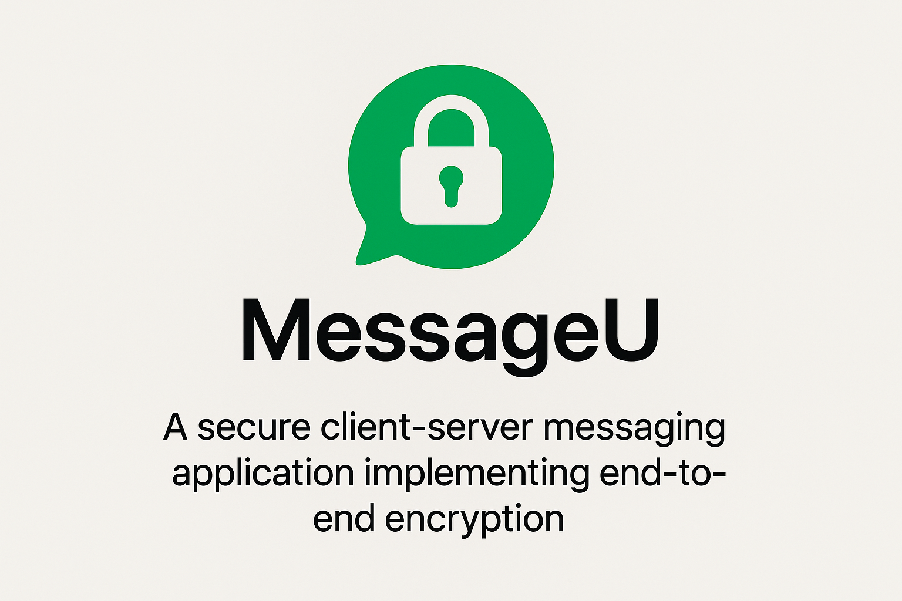

A secure client-server messaging application implementing end-to-end encryption, similar to WhatsApp or Facebook Messenger, developed as part of the Defensive Systems Programming course (20937).

## 📋 Overview

This project implements a pull-based messaging system where clients send messages to a server, which then distributes them to target recipients. The system supports end-to-end encryption, ensuring that only the intended recipients can read the messages.

### Key Features

- **End-to-End Encryption**: Messages are encrypted on the client side and can only be decrypted by the intended recipient
- **Pull-based Architecture**: Clients periodically request messages from the server
- **Multi-user Support**: Server handles multiple concurrent clients using threads or selectors
- **Offline Message Support**: Messages are stored for offline users and delivered when they come online
- **File Transfer**: Support for sending encrypted files between users (bonus feature)

## 🏗️ Architecture

### Server (Python)
- **Language**: Python 3
- **Protocol**: Stateless over TCP
- **Database**: SQLite (defensive.db) for persistent storage
- **Port Configuration**: Reads from `myport.info` file
- **Version**: 2.0 (for bonus features)

### Client (C++)
- **Language**: C++
- **Interface**: Console-based application
- **Encryption**: RSA + AES hybrid encryption
- **Configuration**: Reads server info from `server.info` and user info from `my.info`
- **Version**: 2.0 (for bonus features)

## 📁 Project Structure

```
src/
├── client/          # C++ client implementation
│   ├── *.cpp        # Source files
│   └── *.h          # Header files
└── server/          # Python server implementation
    └── *.py         # Python source files
```

## 🔧 Setup and Installation

### Prerequisites

**Server Requirements:**
- Python 3.x
- SQLite3 (included with Python)

**Client Requirements:**
- C++ compiler (Visual Studio Community 2019 recommended)
- Crypto++ library (version 8.8.0+)
- Winsock or Boost libraries for networking

### Configuration Files

1. **Server Port Configuration** (`myport.info`):
   ```
   1234
   ```

2. **Client Server Configuration** (`server.info`):
   ```
   127.0.0.1:1234
   ```

3. **Client User Configuration** (`my.info`):
   ```
   Michael Jackson
   64f3f63985f04beb81a0e43321880182
   MIGdMA0GCSqGSIb3DQEBA...
   ```

## 🚀 Usage

### Server
```bash
cd src/server
python server.py
```

### Client
```bash
cd src/client
./client.exe
```

### Client Menu Options

```
MessageU client at your service.
110) Register
120) Request for client list
130) Request for public key
140) Request for waiting messages
150) Send a text message
151) Send a request for a symmetric key
152) Send your symmetric key
153) Send a file (bonus)
0) Exit client
```

## 🔐 Security Features

### Encryption Implementation

- **Asymmetric Encryption**: RSA-1024 for key exchange
- **Symmetric Encryption**: AES-128-CBC for message content
- **Key Management**: Automatic generation and exchange of symmetric keys
- **Message Integrity**: End-to-end encryption ensures message authenticity

### Security Considerations

- All messages are encrypted before transmission
- The server cannot decrypt the message content
- Each client pair uses unique symmetric keys
- Public keys are distributed through the server

## 📡 Communication Protocol

### Message Flow

1. **Key Exchange**:
   - Client A requests Client B's public key
   - Client A sends a symmetric key request to Client B (encrypted with B's public key)
   - Client B responds with a symmetric key (encrypted with A's public key)

2. **Message Exchange**:
   - Messages are encrypted with a shared symmetric key
   - Server stores and forwards encrypted messages
   - Recipients decrypt messages using their symmetric key

### Protocol Details

- **Transport**: TCP
- **Encoding**: Little-endian for numeric fields
- **Message Types**: 
  - Symmetric key request (Type 1)
  - Symmetric key exchange (Type 2)
  - Text message (Type 3)
  - File transfer (Type 4 - bonus)

## 🗄️ Database Schema

### Clients Table
| Field | Type | Description |
|-------|------|-------------|
| ID | 16 bytes | Unique client identifier (UUID) |
| UserName | 255 bytes | ASCII username string |
| PublicKey | 160 bytes | Client's RSA public key |
| LastSeen | DateTime | Last client activity timestamp |

### Messages Table
| Field | Type | Description |
|-------|------|-------------|
| ID | 4 bytes | Message ID |
| ToClient | 16 bytes | Recipient client ID |
| FromClient | 16 bytes | Sender client ID |
| Type | 1 byte | Message type |
| Content | Blob | Encrypted message content |

## 🏆 Bonus Features

- **File Transfer** (153): Send encrypted files between clients
- **Persistent Storage**: SQLite database for message and user persistence
- **Enhanced Security**: Additional security measures and protocol improvements

## 🧪 Testing

### Development Guidelines

1. **Modular Development**: Implement components separately and test individually
2. **Incremental Testing**: Start with single client, then add multi-client support
3. **Error Handling**: Comprehensive exception handling throughout the system
4. **Logging**: Server-side logging for debugging and monitoring

### Testing Scenarios

- Client registration and authentication
- Message sending and receiving
- Offline message delivery
- Key exchange mechanisms
- File transfer (bonus feature)
- Error handling and recovery

## 🚨 Error Handling

- **Client-side**: User-friendly error messages and graceful degradation
- **Server-side**: Proper error codes and logging
- **Network**: Connection timeout and retry mechanisms
- **Encryption**: Key validation and error recovery

## 📝 Development Notes

### Code Quality Standards

- **Object-Oriented Design**: Use inheritance, encapsulation, and polymorphism
- **Documentation**: Comprehensive code comments and documentation
- **Memory Management**: Proper resource allocation and cleanup
- **Security**: Input validation and secure coding practices

### Performance Considerations

- **Memory Usage**: Efficient handling of large messages and files
- **Network Optimization**: Minimal protocol overhead
- **Database Optimization**: Efficient query design and indexing

## 📚 Dependencies

### Server (Python)
- Standard library modules only
- `struct` for binary data handling
- `socket` for network communication
- `sqlite3` for database operations
- `threading` for concurrent client handling

### Client (C++)
- STL (Standard Template Library)
- Crypto++ library for encryption
- Winsock or Boost for networking
- C++11 features (auto, lambda functions, etc.)

## 🤝 Contributing

This is an academic project. Please ensure:
- No external code-sharing or collaboration
- Use only approved libraries and resources
- Follow the specified development guidelines
- Maintain academic integrity standards

## 📄 License

This project is developed as part of an academic assignment for the Defensive Systems Programming course. All rights reserved.

---

**Assignment Details:**
- Course: Defensive Systems Programming
- Assignment 15
- Semester: 2025A

**Note**: This implementation is designed for educational purposes and demonstrates secure communication protocols, encryption techniques, and network programming concepts.
